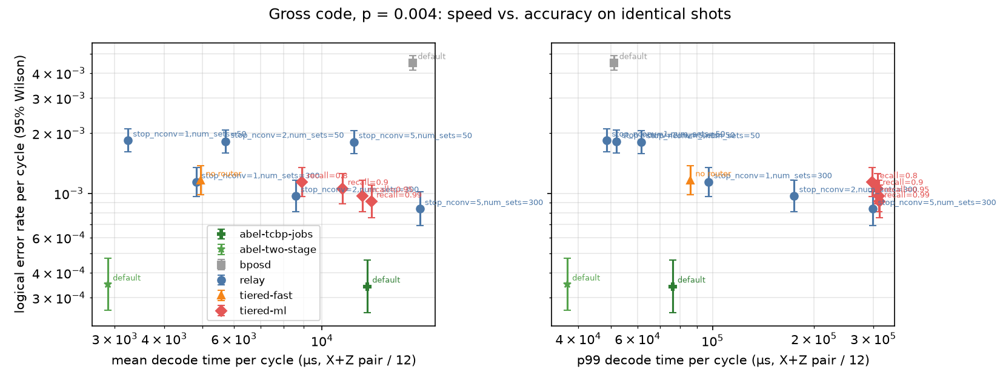
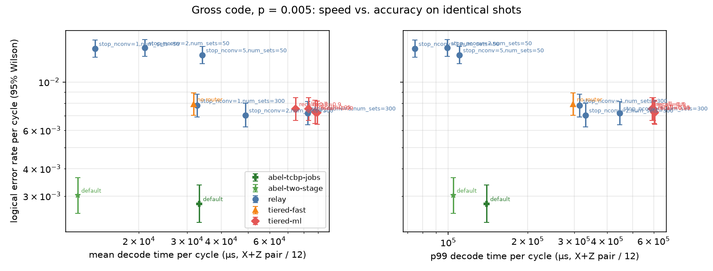

# Option B: the team's TCBP-JOBS decoder against relay-BP's whole trade-off curve

The team's decoders (branch `develop/Abel`) were timed in our harness, unchanged, under exactly
the rules used for relay-BP's curve:
- the same cached seed-1 shots: p=0.004 at 10,000 per basis, p=0.005 at the first 3,000;
- Apple M4, 4 worker processes, **one thread per shot** (`NUMBA_NUM_THREADS=1`);
- timing covers the `decode()` call only, after numba compilation;
- 95% Wilson intervals, rates per cycle.

Abel's Kaggle shots are the same seed-1 shots as ours. That was checked bit for bit, so NVIDIA's
own CUDA-Q TCBP-JOBS (41 failed pairs at p=0.004) is on the same shots as well.

## Headline

**The two-stage TCBP-JOBS decoder beats every relay-BP setting on accuracy and speed, at both
error rates, single-threaded.**

### p = 0.004 (10,000 pairs)

| decoder | failed pairs | per cycle [95% CI] | mean | median | p99 | p99.9 |
|---|---|---|---|---|---|---|
| **TCBP-JOBS two-stage** | **42** | **3.5e-4** [2.6, 4.7] | **34.6 ms** | 15.8 ms | **445 ms** | 1.01 s |
| TCBP-JOBS full | 41 | 3.4e-4 [2.5, 4.6] | 156 ms | 92 ms | 913 ms | 1.64 s |
| NVIDIA CUDA-Q TCBP-JOBS (Kaggle T4, Abel) | 41 | 3.4e-4 | (GPU, not comparable) | | | |
| relay `stop_nconv=5` (default) | 100 | 8.4e-4 [6.9, 10.2] | 212 ms | 71 ms | 3.59 s | 3.83 s |
| relay `stop_nconv=2` | 116 | 9.7e-4 [8.1, 11.7] | 103 ms | 24 ms | 2.10 s | 3.62 s |
| relay `stop_nconv=1` | 136 | 1.14e-3 [0.96, 1.35] | 58 ms | 9 ms | 1.17 s | 3.42 s |
| relay `stop_nconv=1, num_sets=50` (fastest) | 219 | 1.84e-3 | 38.9 ms | 9.5 ms | 583 ms | 673 ms |
| BP-OSD | 527 | 4.5e-3 | 203 ms | 222 ms | 613 ms | 710 ms |

- Against relay-BP's default: **2.4× fewer errors at 6.1× less mean time and 8× lower p99.**
- Against relay-BP's *fastest* setting: still faster (34.6 vs 38.9 ms), with 5.2× fewer errors
  and lower p99.
- The error bars do not overlap any relay-BP point.

### p = 0.005 (3,000 pairs)

| decoder | failed pairs | per cycle [95% CI] | mean | median | p99 |
|---|---|---|---|---|---|
| **TCBP-JOBS two-stage** | **107** | **3.0e-3** [2.5, 3.6] | **144 ms** | 27 ms | 1.25 s |
| TCBP-JOBS full | 98 | 2.8e-3 [2.3, 3.4] | 399 ms | 286 ms | 1.68 s |
| relay `stop_nconv=2` (best relay accuracy) | 244 | 7.0e-3 [6.2, 8.0] | 587 ms | 99 ms | 3.97 s |
| relay `stop_nconv=5` (default) | 249 | 7.2e-3 [6.4, 8.1] | 992 ms | 288 ms | 5.35 s |
| relay `stop_nconv=1, num_sets=50` (fastest) | 474 | 1.42e-2 | 166 ms | 38 ms | 897 ms |

- Against relay-BP's best setting: **2.3× fewer errors at 4.1× less mean time and 3.2× lower p99.**
- Only relay-BP's fastest setting has a lower p99 (0.90 vs 1.25 s), and it makes 4.4× more errors.

## Consistency checks
- Our runs reproduce Abel's own counts on these shots (two-stage 42, full 41 at p=0.004), and
  match NVIDIA's code (41).
- Our single-thread means (two-stage 34.6 ms, full 156 ms at p=0.004) are close to Abel's
  single-thread measurements on 300 pairs (31.9 and 134 ms) on a different Apple chip.
- The two-stage threshold (τ = 15) was set by Abel on these test shots and then checked on
  fresh shots (seed 21): it holds (`README_ABEL.md`). It is not tuned on our numbers here.

## Caveats for the presentation
- These are CPU timings (`decode()` call only), not hardware latency. With 12 threads, Abel
  measured two-stage at 18.5 ms.
- The NVIDIA GPU number (21 ms per pair on a T4) used `decode_batch` with `bp_batch_size=1`
  (the run printed a warning), so the GPU decoded shots one at a time. It is not a measure
  of what NVIDIA's decoder can do with batching or on their GB200 hardware.
- p=0.005 uses 3,000 shots per basis. The gaps are many standard errors wide, so this is enough.
- Environment note: with torch installed, numba must use `NUMBA_THREADING_LAYER=workqueue`
  (a duplicate OpenMP runtime otherwise aborts). `bench/run_decoder.py` sets it automatically.

## Where our own work fits
- **relay-BP's trade-off curve** (Phase 1) is what makes the claim "beats *every* relay-BP
  setting" possible. Without it, the comparison is only against the default.
- **The tiered relay-BP gating** (Phase 1 and Option A) is a negative result. A learned per-shot
  stopping rule for relay-BP reaches at best relay `stop_nconv=2`. Even a perfect router
  (7.0e-4 at 65 ms) stays behind TCBP-JOBS two-stage (3.5e-4 at 35 ms).
- Two findings with no ML involved:
  - relay `stop_nconv=2` matches the default's accuracy at half the cost;
  - `num_sets` must stay large.

Reproduce (from the kit directory, with a checkout of `develop/Abel` as `ABEL_KIT`):

    export ABEL_KIT=/path/to/abel-checkout/challenge-1-ml-decoder-kit
    python -m bench.run_decoder --decoder abel-two-stage --p 0.004 --shots 10000 --workers 4
    python -m bench.run_decoder --decoder abel-tcbp-jobs --p 0.004 --shots 10000 --workers 4
    python -m bench.pareto --p 0.004
