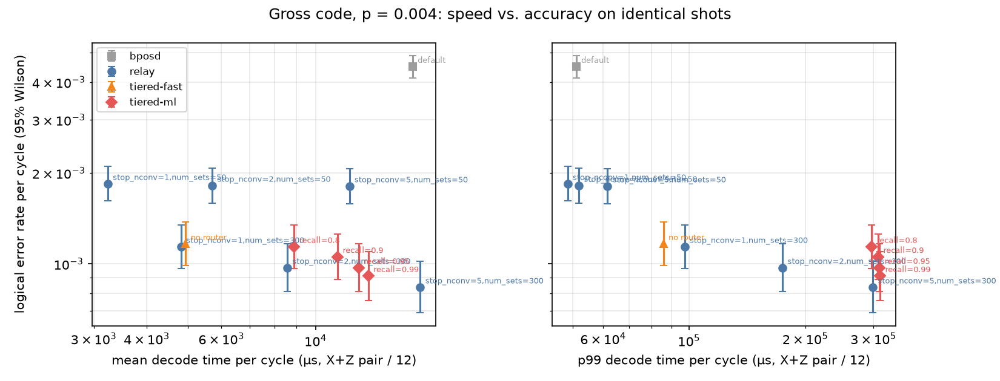
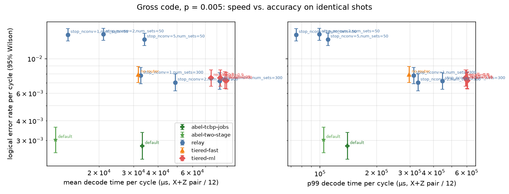

# Phase 1 analysis: relay-BP's own trade-off curve vs. the tiered decoder

## Summary in plain words

We asked whether a learned "how hard is this shot?" router can make relay-BP faster at the
same accuracy than *any* fixed relay-BP setting can. **With the current router, no.** Simply
telling relay-BP to stop after 2 solutions instead of 5 is as accurate and about 2× faster,
and our router does not beat that.

The approach is not dead, though. A *perfect* router would be about 3× faster than every
relay-BP setting **and** more accurate. The router is the weak link: it has to find about 1 shot
in 40 among the hard ones, and its current features cannot. That is what we work on next
(Option A).

*Blue: relay-BP at 6 fixed settings. Orange: tiered-fast. Red: tiered-ml at 4 router thresholds.
Lower is more accurate, further left is faster. Left panel: mean time. Right panel: p99 time.
Error bars: 95% Wilson intervals.*

Setup:
- Identical cached shots (seed 1). p=0.004: 10,000 per basis. p=0.005: first 3,000 per basis.
- Apple M4, 4 workers, one thread per shot, timing covers the `decode()` call only.
- Error rates are per cycle with 95% Wilson intervals. Times are per X+Z pair.
- Tables: `pareto_p0.004.csv`, `pareto_p0.005.csv`. Plots: `pareto_p0.004.png`, `pareto_p0.005.png`.

## Checkpoint 1 answer: **no, tiered-ml is not beyond relay-BP's curve**

### p = 0.004

| decoder | per cycle [95% CI] | mean | p99 |
|---|---|---|---|
| relay `stop_nconv=1` | 1.14e-3 [0.96, 1.35] | 58 ms | 1.17 s |
| relay `stop_nconv=2` | 9.7e-4 [0.81, 1.17] | 103 ms | 2.10 s |
| relay `stop_nconv=5` (default) | 8.4e-4 [0.69, 1.02] | 212 ms | 3.59 s |
| tiered-fast | 1.17e-3 [0.99, 1.38] | 59 ms | 1.03 s |
| tiered-ml, recall 0.95 | 9.7e-4 [0.81, 1.17] | 152 ms | 3.74 s |
| tiered-ml, recall 0.99 | 9.1e-4 [0.76, 1.10] | 160 ms | 3.75 s |

### p = 0.005

| decoder | per cycle [95% CI] | mean | p99 |
|---|---|---|---|
| relay `stop_nconv=1` | 7.8e-3 [6.9, 8.8] | 391 ms | 3.76 s |
| relay `stop_nconv=2` | 7.0e-3 [6.2, 8.0] | 587 ms | 3.97 s |
| relay `stop_nconv=5` (default) | 7.2e-3 [6.4, 8.1] | 992 ms | 5.35 s |
| tiered-fast | 7.9e-3 [7.0, 8.9] | 380 ms | 3.57 s |
| tiered-ml, recall 0.95 | 7.3e-3 [6.4, 8.2] | 1054 ms | 7.23 s |

- **Every tiered-ml point lies on or behind relay-BP's frontier.** At p=0.004, recall 0.95 has
  the same error rate as relay `stop_nconv=2` and takes 1.5× as long. At p=0.005 tiered-ml is
  slower than relay-BP's default and no more accurate. Its p99 is the worst of all
  configurations.
- **tiered-fast is relay `stop_nconv=1`**, as the plan warned: same accuracy, same speed.

## Findings worth keeping (no ML needed)

1. **Relay-BP's default is over-provisioned.**
   - `stop_nconv=2` is as accurate as `stop_nconv=5` within error bars at both p.
   - At p=0.005 it is slightly better on the point estimate: 7.0e-3 vs 7.2e-3.
   - It costs about half the time: 103 vs 212 ms at p=0.004, 587 vs 992 ms at p=0.005.
2. **Long relay chains matter.** Cutting `num_sets` from 300 to 50 roughly doubles the error
   rate at every `stop_nconv` (1.8e-3 vs 0.8–1.1e-3 at p=0.004). The hard shots need many legs.
3. **Stage 1 is nearly free and nearly safe.** It accepts 85.8% of shots at p=0.004 and 63.8% at
   p=0.005, at about 5–9 ms each, with 10 wrong in 17,164 and 6 wrong in 3,829. A relay-BP run
   already does this first leg internally, so stage 1 saves little against relay-BP itself.
4. **Stage 3 is not monotone.** At p=0.004 escalating fixes 56 hard shots but breaks 21 that the
   first solution had right. At p=0.005 it fixes 80 and breaks 54. "Pick the lowest-weight
   candidate" is sometimes wrong.

## Why tiered-ml fails, and what an ideal router would do

Per hard shot at p=0.004, stage 2 costs about 171 ms and stage 3 about 401 ms. Stage 3 reruns
relay-BP from scratch. The router flags too much:
- at recall 0.95 it escalates 6.6% of all shots at p=0.004 and 27% at p=0.005;
- the shots that escalation actually fixes are only 0.28% and 1.3%.

**Oracle bound** (a router that escalates exactly the shots stage 3 fixes; uses the truth, so it
is a ceiling, not a result):

| p | oracle tiered | relay default | relay `stop_nconv=2` |
|---|---|---|---|
| 0.004 | **7.0e-4 at 65 ms** (p99 1.3 s) | 8.4e-4 at 212 ms | 9.7e-4 at 103 ms |
| 0.005 | **5.6e-3 at 424 ms** (p99 4.2 s) | 7.2e-3 at 992 ms | 7.0e-3 at 587 ms |

The design has room: a perfect router would beat every relay-BP setting by about 3× in time
and would also be more accurate. **The bottleneck is the router's selectivity.** It must find
about 56 fixable shots among about 2,400 hard ones, and summary features of one relay solution
cannot do that (64% flagged at 95% recall).

## Implications for Phase 2

- Better router features are the only lever. Per-bit posterior statistics and a
  gradient-boosted model can be tested on the saved tiered-all logs plus features. Training
  labels should be "stage 3 fixes it" rather than "stage 3 disagrees".
- A cheaper stage 3 (`stop_nconv=1` more, not 4) lowers the cost of each false alarm.
- Against the team's TCBP-JOBS decoder (`develop/Abel`: about 3.4e-4 at about 42 ms, 12
  threads), even the oracle tiered decoder (7.0e-4 at 65 ms) is behind. The tiered approach is
  best presented as a supporting analysis:
  - relay-BP's own curve, the reference any decoder should be compared against;
  - the `stop_nconv=2` finding;
  - an honest negative result on gating relay-BP.
